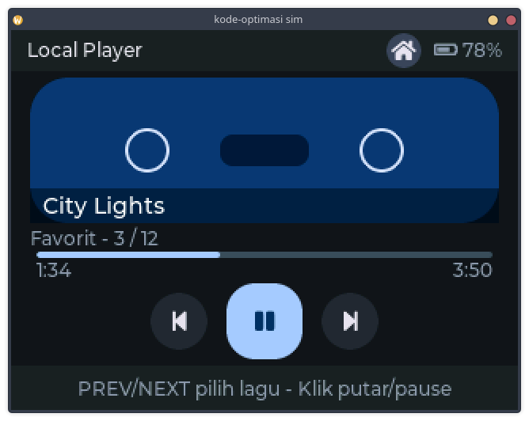
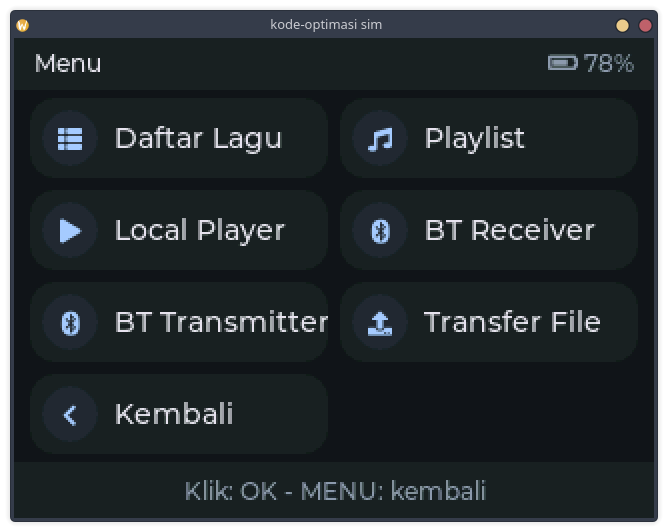
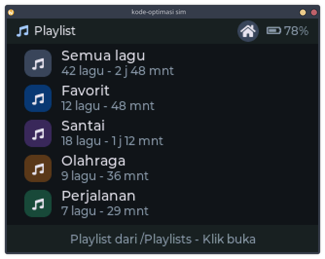

# DAP-Esp32Devkit

ESP32-based portable audio player (SD card → Bluetooth A2DP source), with a
rotary encoder + button UI on an ILI9341 display.

  
  
  

<em>LVGL UI preview (<code>kode-optimasi/</code>) — more screenshots in <a href="kode-optimasi/README.md">kode-optimasi/README.md</a></em>

## Layout

- **`final-form/`** — the firmware. Start here. See `final-form/README.md`
  for wiring, controls, SD card layout, and build instructions.
- **`kode-optimasi/`** — standalone LVGL 8.x port of all 12 UI boards (not
  wired into `final-form/`). Has its own desktop SDL preview (`sim/`) and
  screenshot gallery — see `kode-optimasi/README.md`.
- **`old/`** — original/reference material kept for history:
  - `old/Stream32-ESP-Player.ino` — the original full-feature UI/player this
    project's feature set was ported from (different hardware: TFT_eSPI +
    touchscreen).
  - `old/files/` — this board's real wiring tests (`test_input.ino`), the
    pinout plan (`plan.md`), case/render assets, and an earlier PlatformIO
    attempt (`esp32-dap/`).
  - `old/files.zip` — a zip of `old/files/`, ignored by git (duplicate of
    already-tracked content).
- **`docs/`** — porting notes; see `docs/porting-notes.md`.
