# DAP UI 240x320 (Material)

- `ui-preview.html`: semua layar dalam satu halaman (buka di browser; font Roboto butuh internet, tanpa itu memakai font sans-serif bawaan).
- `source/`: file asli canvas (`canvas.json` dan `*.dc.html`). File `.dc.html` tidak butuh runtime Design untuk tampil -- bagian yang terlihat cuma HTML/CSS/SVG statis, cuma skrip editornya yang butuh runtime itu. `screenshots/` adalah hasil render tiap file lewat `google-chrome-stable --headless --screenshot` pada ukuran asli 240x320, dipakai di bawah ini.
- Desain online: https://claude.ai/artifact/Bq3bm5KEzP8QeHG6o17VTZ (pribadi sampai kamu membagikannya).

Catatan: desain belum diterapkan 1:1 ke firmware -- firmware pakai landscape 320x240 (bukan portrait 240x320 di sini), jadi tiap layar direinterpretasi ke grid/geometri landscape, bukan dicopy mentah. Playlist diasumsikan dari file .m3u di /Playlists.

## Layar

| | | |
|---|---|---|
| 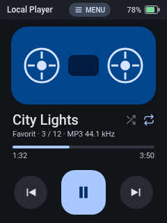 1. Now Playing | 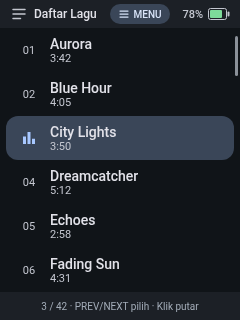 2. Daftar Lagu | 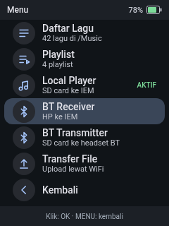 3. Menu mode |
| 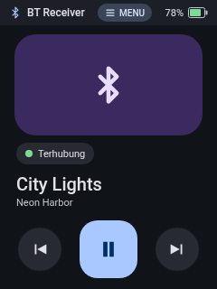 4. BT Receiver | 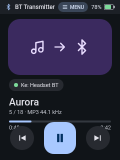 5. BT Transmitter | 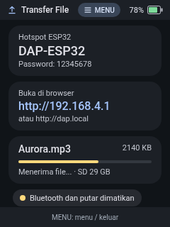 6. Transfer File |
| 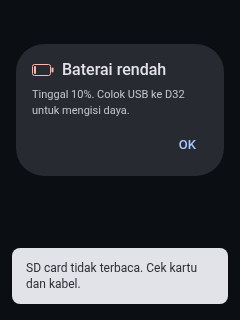 7. Overlay (baterai rendah, SD error) | 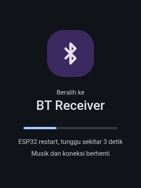 8. Beralih mode | 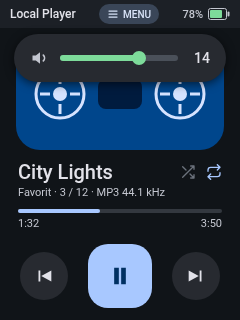 9. Indikator volume |
| 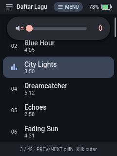 10. Indikator volume (senyap) | 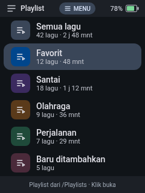 11. Daftar playlist | 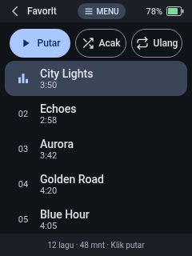 12. Isi playlist |
