# DAP UI landscape 320x240 (Material)

- `ui-preview.html`: 12 layar landscape dalam satu halaman, ukuran asli 320x240 (buka di browser; font Roboto butuh internet).
- `source/`: file asli canvas (`canvas.json`, `L_*.dc.html`). Tidak butuh editor Design untuk tampil -- bagian yang terlihat cuma HTML/CSS/SVG statis. `screenshots/` adalah hasil render tiap file lewat `google-chrome-stable --headless --screenshot` pada ukuran asli 320x240, dipakai di galeri bawah.
- Desain online: https://claude.ai/artifact/Bq3bm5KEzP8QeHG6o17VTZ

## Galeri

| | | |
|---|---|---|
| 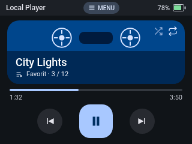 1. Now Playing | 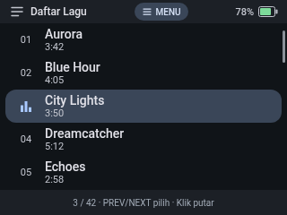 2. Daftar Lagu | 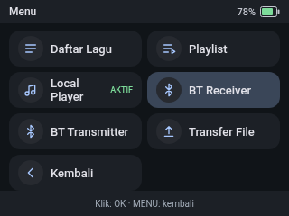 3. Menu mode |
| 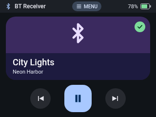 4. BT Receiver | 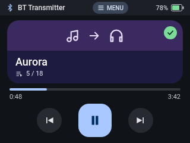 5. BT Transmitter | 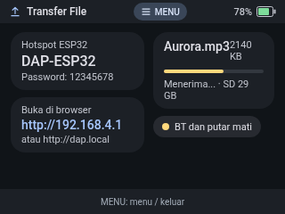 6. Transfer File |
| 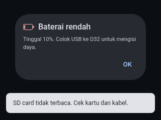 7. Baterai rendah dan error | 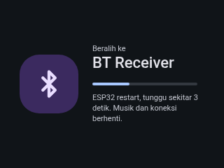 8. Beralih mode | 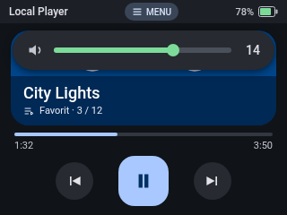 9. Volume berubah |
| 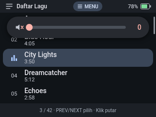 10. Volume senyap | 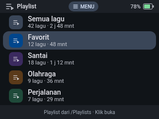 11. Daftar playlist | 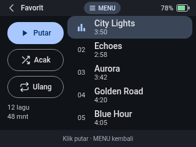 12. Isi playlist |

Catatan: sudah diterapkan ke firmware (`final-form/`) -- ini desain acuan yang
dipakai, bukan `dap-ui-design/` (portrait, lama, sudah dihapus). Sampul
ilustrasi kaset di mockup ini diganti sampul album asli di firmware: panel
Now Playing (Local Player & BT Transmitter) menampilkan `/tracks/<nama>.raw`
(94x94, RGB565) kalau ada, jatuh ke ikon nada kalau tidak -- BT Receiver
tetap pakai ikon bluetooth (tidak ada file lokal untuk ditampilkan). Playlist
diasumsikan dari file .m3u di /Playlists.
