# kode-optimasi — LVGL port of the 12-board DAP UI

Standalone LVGL 8.x reimplementation of all 12 screens from
`../dap-ui-landscape/` (design reference) / `../DAP_UI_landscape_240x320_pixel_export/`
(pixel export), for an ESP32 DevKit V1 (WROOM-32, **no PSRAM**) driving a
320×240 landscape SPI TFT (ILI9341 by default; ST7789-compatible) via TFT_eSPI.

**Scope**: this is a UI shell with demo/static sample data (the same text the
mockups themselves use — "Aurora 3:42", "Favorit · 12 lagu", etc). There is no
SD-card/audio/Bluetooth/WiFi backend here and none is wired up — that
integration is a separate, later pass. `../final-form/` is the real firmware
and is untouched by this folder.

## Galeri

Screenshot nyata dari `sim/` (lihat di bawah), bukan mockup — rendernya 100%
lewat LVGL asli + sumber `screen_*.cpp` yang sama persis dengan yang jalan di
ESP32.

| | | |
|---|---|---|
| 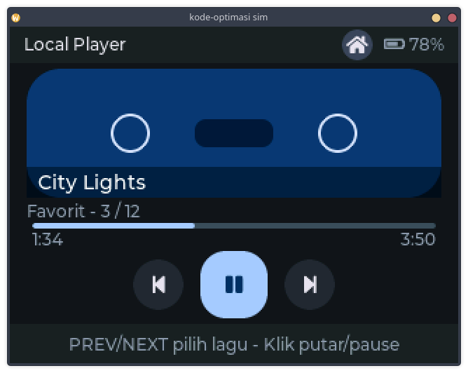 1. Now Playing | 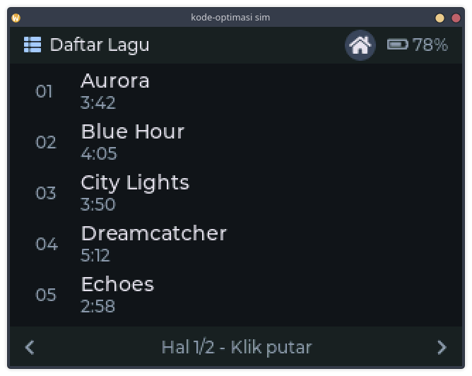 2. Daftar Lagu | 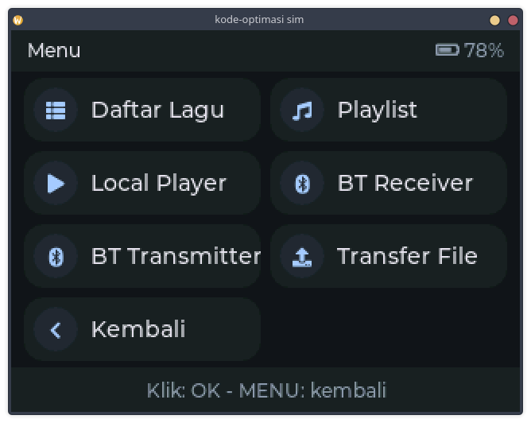 3. Menu mode |
| 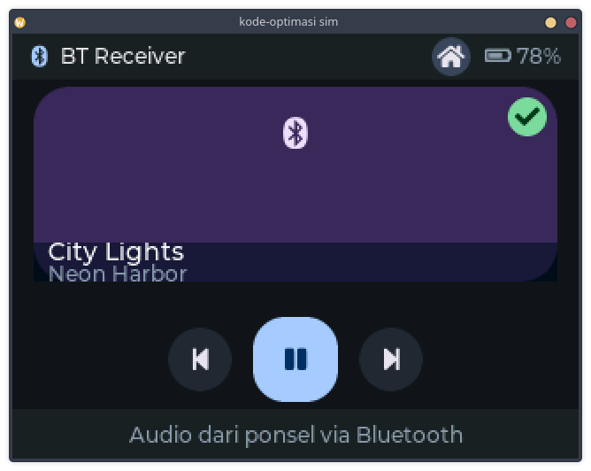 4. BT Receiver | 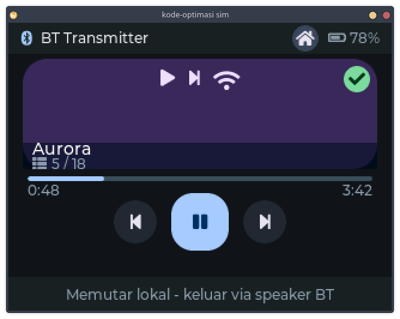 5. BT Transmitter | 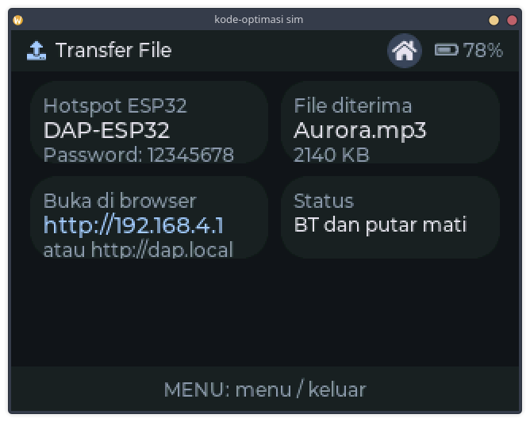 6. Transfer File |
| 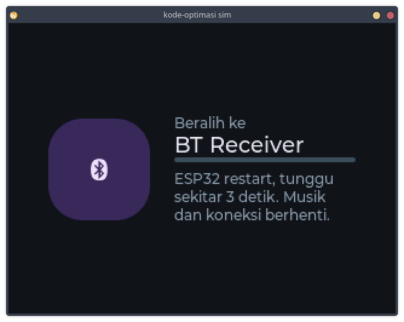 7. Beralih mode | 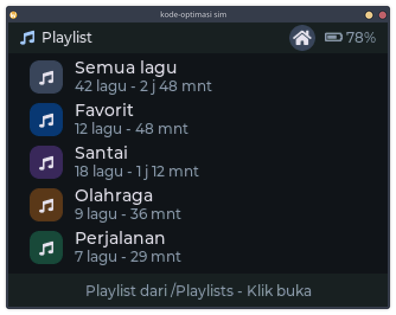 8. Daftar playlist | 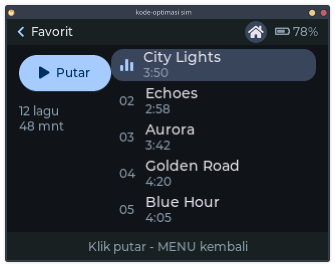 9. Isi playlist |
| 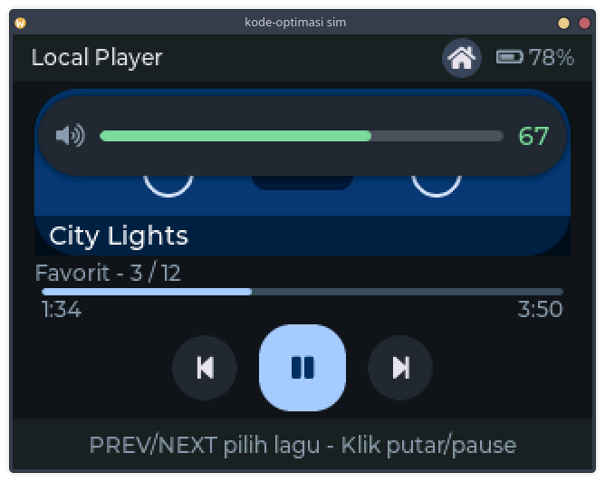 10. Volume HUD (overlay) | 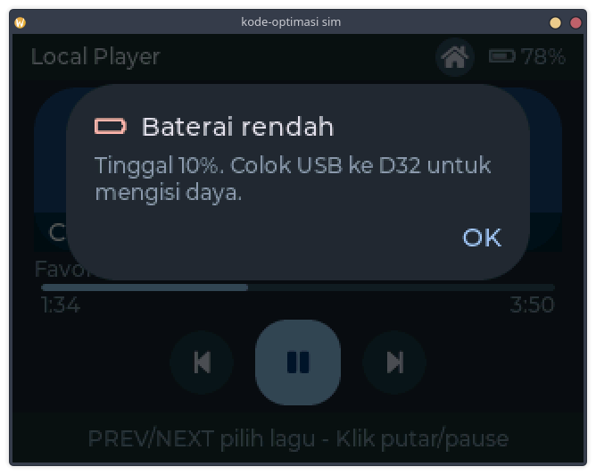 11. Baterai rendah (overlay) | 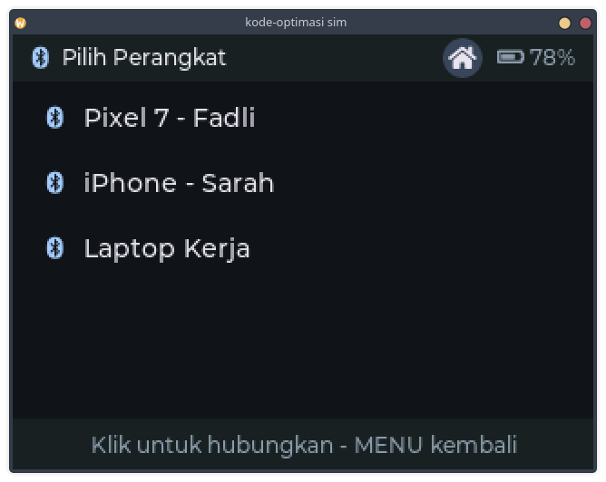 12. Pilih Perangkat — RX |
| 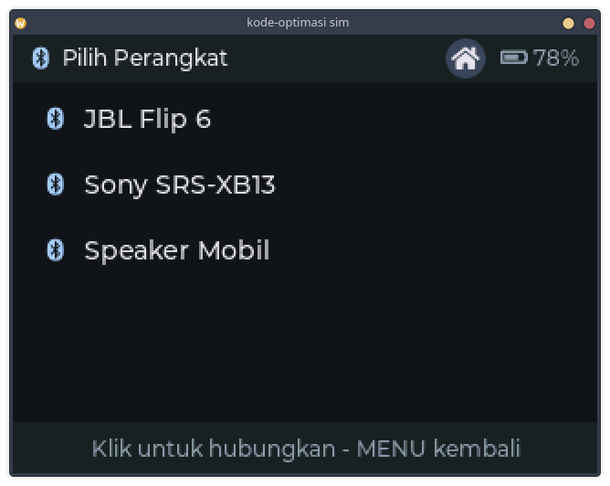 13. Pilih Perangkat — TX | | |

## Board → file map

| Board | Screen | File |
|---|---|---|
| L1 | Now Playing | `screen_now_playing.*` (+ `cassette_anim.*`) |
| L2 | Daftar Lagu | `screen_library.*` |
| L3 | Menu mode | `screen_menu.*` |
| L4 | BT Receiver | `screen_receiver.*` |
| L5 | BT Transmitter | `screen_transmitter.*` |
| L6 | Transfer File | `screen_transfer.*` |
| L7 | Baterai rendah + SD error | `overlay_alert.*` (modal + toast) |
| L8 | Beralih mode | `screen_switch.*` |
| L9 / L10 | Volume berubah / senyap | `overlay_volume.*` (one widget, 2 states) |
| L11 | Daftar playlist | `screen_playlists.*` |
| L12 | Isi playlist | `screen_playlist_detail.*` |
| *(baru)* | Pilih Perangkat (RX/TX) | `screen_bt_devices.*` — not one of the original 12 boards; added so BT Receiver/Transmitter have an actual menu to connect to a device from, instead of just claiming "Terhubung" with nothing chosen. Menu's BT tiles go here first; the connected badge on Receiver/Transmitter taps back to it ("ganti perangkat"). |

Shared chrome/icons/theme: `ui_common.*`, `ui_icons.*`, `ui_theme.h`.
Lazy screen lifecycle (only one screen's widgets exist at a time, to fit a
no-PSRAM budget across 9+ screens): `screen_manager.*`.

## Navigation

Real click-driven navigation (not just the demo data):
- Any screen's "MENU" badge (top-right, home icon) → Menu grid.
- A Menu tile → that screen (Daftar Lagu, Playlist, Local Player, Transfer
  File; "Kembali" → Now Playing). The two BT tiles go to **Pilih Perangkat**
  (`screen_bt_devices.cpp`, not one of the original 12 boards) first.
- A device row on Pilih Perangkat → BT Receiver/Transmitter (whichever list
  it was); the "Terhubung" badge there taps back to that same device list
  ("ganti perangkat") — a real round trip, not a dead-end "always connected".
- A Playlists row → that playlist's detail screen; the detail screen's
  back-chevron → back to Playlists.
- A Library row / a Playlist-detail track row → "play this song" (jumps to
  Now Playing) — no row highlight/selection anywhere in these lists by
  design.
- Playlist-detail's "Putar" button → jumps to Now Playing (a real "play this
  playlist" action); "Acak"/"Ulang" are plain buttons with no real
  shuffle/repeat engine behind them, so they intentionally don't fake a
  persistent toggle state — just the same press feedback as everything else.

**Also real, not just decorative anymore**:
- Play/pause (Now Playing, BT Receiver, BT Transmitter) actually toggles —
  icon swaps, and on Now Playing it also pauses the cassette-reel spin
  (`cassette_anim_set_spinning`) and **stops the elapsed-time clock**
  (`demo_cycle.cpp` checks `now_playing_is_playing()` before ticking).
- Prev/next (same three screens) actually cycles through a small demo
  track list — title/subtitle change, and on Now Playing the progress bar
  and elapsed/total time reset and track **that song's own duration**
  (`screen_now_playing.cpp`'s `kDemoTracks[].duration_sec`), not a single
  duration shared by every song.
- Volume (`overlay_volume.cpp`) is a real persistent 0–100 level, not a
  fixed number from a timer — in `sim/`, scroll the mouse wheel to
  raise/lower it.
- Every clickable element gives real press feedback (dims while actually
  held down, via LVGL's native `LV_STATE_PRESSED` — see
  `ui_button_create`/`ui_list_row_create` in `ui_common.cpp`) and reverts the
  instant it's released; nothing stays "selected" just because it was
  clicked once.

**Still demo-only by design**: the battery percentage (`now_playing_set_battery()`
is a no-op stub) and anything that would need real SD/audio/BT/WiFi hardware
(song durations/metadata, BT "Terhubung" status, transfer progress, etc).

**Click handling itself only responds in the desktop `sim/`** (see below) —
real hardware has no touch/button input device registered yet (not in the
original brief). The handlers live in the shared screen code, so wiring a
touch (e.g. XPT2046) or physical-button indev into `kode-optimasi.ino` later
is all that's needed to make the same clicks work on-device.

## Build setup

1. **Libraries**: `lvgl` (^8.3) and `TFT_eSPI` (^2.5), both installable via the
   Arduino Library Manager or PlatformIO `lib_deps`.
2. **`lv_conf.h`** (already in this folder):
   - Arduino IDE: install **lvgl via the Arduino Library Manager** (the
     Arduino-packaged build, not the raw GitHub repo) — it auto-detects
     `lv_conf.h` sitting in the sketch folder, nothing else to do.
   - PlatformIO: the generic `lvgl/lvgl` package does **not** auto-discover a
     project-local `lv_conf.h` — verified by actually building this folder
     with `pio run`. It needs two build flags (already in the `platformio.ini`
     included in this folder): `-D LV_CONF_INCLUDE_SIMPLE=1` and `-I.`
     (so lvgl's `#include "lv_conf.h"` resolves to this folder).
3. **TFT_eSPI pin/driver config** — TFT_eSPI needs these at library-compile
   time, not sketch-time:
   - Arduino IDE: copy `TFT_eSPI_User_Setup.h`'s contents into
     `<Arduino/libraries>/TFT_eSPI/User_Setup.h`.
   - PlatformIO: pass the same `#define`s from that file as `build_flags`
     instead — already done in the included `platformio.ini`.
   - Panel is ILI9341 by default (matches the real hardware this pin layout
     was copied from, `final-form/pins.h`) — swap `ILI9341_DRIVER` for
     `ST7789_DRIVER` if your panel is ST7789.
4. Flash `kode-optimasi.ino` (Arduino IDE) or `pio run -t upload` (PlatformIO —
   `platformio.ini` sets `src_dir = .` like `final-form/` does). No touch/button
   input is wired on real hardware yet (see Navigation above), so it just sits
   on Now Playing with its cosmetic demo timers running.

Verified by actually compiling this folder for `esp32dev`/Arduino against real
`lvgl@8.4.0` + `TFT_eSPI@2.5.43`: links cleanly, **RAM 17.8% (58.2 KB), Flash
62.8%** on a 320 KB/1.3 MB ESP32 — confirms the no-PSRAM RAM budget holds with
all 9 screens + 2 overlays linked in (only one screen's widgets exist at a time
at runtime, per the lazy screen lifecycle in `screen_manager.cpp`). Real
on-device flashing is still needed to confirm visuals/timing.

## Desktop preview (`sim/`)

`sim/` renders the real, unmodified screen/overlay sources in an SDL2 window
instead of a TFT panel — same idea as `final-form/sim/`, but against a real
lvgl checkout (lvgl's C source is compiled as C via `gcc`; mixing it into a
C++ `g++` build silently miscompiles it — g++ rejects valid C like implicit
`void*`->`T*` conversions). `cd sim && make sim` (needs network once, to `git
clone` lvgl; needs the `sdl2` dev package via pkg-config) then `./sim`. The
sim registers a real SDL mouse pointer as an LVGL indev, so the navigation
above responds to actual clicks in the window, not a scripted demo.

This caught three real bugs no static review did:
- `lv_obj_set_style_margin_top` doesn't exist in LVGL 8.x (fixed → `pad_top`).
- The original `screen_manager_show()` built the next screen *before*
  freeing the previous one, so for a moment both screens' widgets existed at
  once — on hardware that can blow the no-PSRAM memory pool; in the sim it
  segfaulted inside LVGL's theme code under the deliberately tiny 24 KB pool.
  Fixed by reusing one persistent root screen and `lv_obj_clean()`-ing it
  before rebuilding, so only one screen's widgets ever exist
  (`screen_manager.cpp`).
- There was no input device *and* no click handlers at all at first — every
  screen was pure decoration, auto-cycled by a timer, so nothing was
  navigable. Fixed as described in Navigation above; the old screen-auto-cycle
  timer was removed from `demo_cycle.cpp` since it fought manual clicks.
- Separator text used a UTF-8 "·" (middle dot). LVGL's built-in Montserrat
  fonts only ship the Basic Latin range by default — no Latin-1 Supplement —
  so "·" rendered as a tofu/box glyph. Fixed by switching every occurrence to
  a plain ASCII "-".
- Every clickable widget gave *zero* visual feedback on click at first
  (`ui_card_create`/`ui_button_create` strip the default theme's own press
  style via `remove_style_all`). Fixed with an explicit `LV_STATE_PRESSED`
  style on buttons/rows (see Navigation above) instead of reintroducing the
  theme.

## Known simplifications (see `ponytail:` comments in code for more)

- LVGL's built-in Montserrat font has no bold weight — the spec's "bold"
  title uses the regular 18px face.
- Icons use LVGL's built-in `LV_SYMBOL_*` glyph font, not hand-drawn vector
  art, wherever a matching glyph exists (play/pause/bluetooth/battery/etc.) —
  simpler and still zero bitmap assets. Only the cassette reel (no built-in
  equivalent) is custom vector art (`lv_line` + style-transform rotation).
- `now_playing_set_battery()` is a no-op stub; the header battery is demo-static
  (explicitly out of scope — everything else that looked like a dummy control
  was wired to real, persistent local state instead, see Navigation above).
